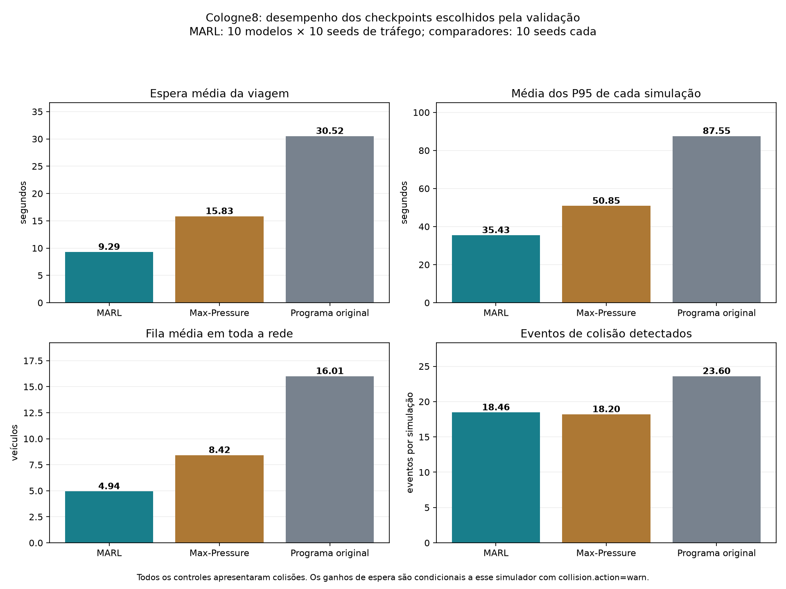
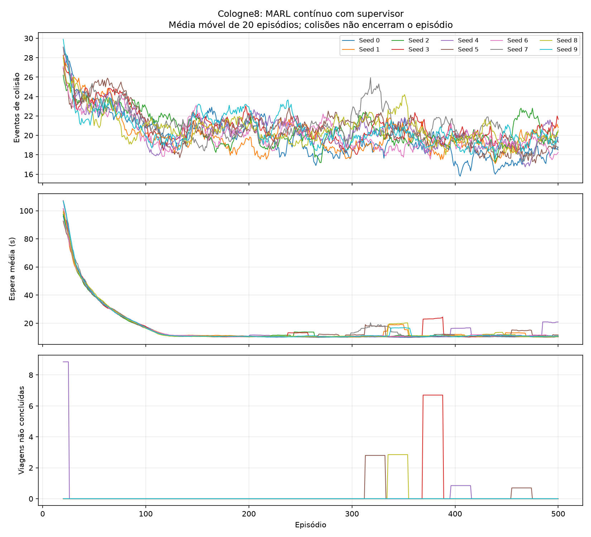

# Análise do MARL com supervisor no Cologne8

A rodada longa terminou em **13/11/2026 às 06h39, horário de São Paulo**, com
dez inicializações, 500 episódios por inicialização e oito agentes locais
mais um supervisor em cada experimento. O MARL apresentou **41,31% menos
espera média e 30,32% menos P95 que o Max-Pressure implementado**, atendendo
todas as viagens dos testes finais. **A segurança continua sem solução:
houve colisões em todos os testes, em quantidade semelhante ao Max-Pressure.**

Esta análise segue a lógica da comparação da DQN C: média e cauda da espera,
veículos não atendidos, resultados por aproximação, intervenções, comparação
pareada por semente e variabilidade entre redes. Acrescenta a análise das
colisões e do canal do supervisor, necessárias neste cenário.

## Experimento analisado

Rodada: `resultados/marl_cologne8/20261113T011843Z_continuo_10seeds_9f8d757b/`.
O relatório automático original permanece em
[RELATORIO.md](resultados/marl_cologne8/20261113T011843Z_continuo_10seeds_9f8d757b/RELATORIO.md).

| Etapa | Quantidade e finalidade |
|---|---|
| Treinamento | 10 sementes de inicialização, 0 a 9, com 500 episódios cada |
| Validação | A cada 25 episódios, tráfego 201 e 202: 400 simulações |
| Teste final do MARL | 10 checkpoints escolhidos pela validação × 10 sementes de tráfego: 100 simulações |
| Ablação | Mesmos checkpoints, orientação fixada em equilibrado: 100 simulações |
| Comparadores | Max-Pressure e programa original, dez sementes cada: 20 simulações |
| Total | 5.620 simulações, incluindo 5.000 episódios de treino |

As sementes de tráfego do treino são `1000 + episódio`; as do teste final,
1 a 10. Os checkpoints são escolhidos apenas pelas validações 201/202,
priorizando menos colisões, depois menos viagens não concluídas e depois
menor espera. Cada checkpoint reúne os nove atores do mesmo episódio.

O cenário é **cologne8 do SUMO-RL 1.4.5**, executado no SUMO 1.28.0. Inclui
os oito semáforos desse recorte e 2.046 viagens com origens, destinos e
horários fixos. O SUMO calcula as rotas. As sementes variam a execução
estocástica; não criam dez novas demandas. Não representa toda a cidade de
Colônia e não utiliza observações de trânsito ao vivo.

Cada episódio percorre os 3.600 s de demanda, entre 25.200 e 28.800 s SUMO,
mais até 1.200 s de escoamento. A exposição de treinamento foi de
**5.362,22 horas simuladas**, somando os relógios dos dez experimentos.
Esse valor não é multiplicado pelos oito cruzamentos da mesma simulação.

O código de execução foi congelado em `fontes_execucao/`. A rodada começou
com pesos novos, preservando os modelos DQN13, DQN17 e MARL anteriores.
Mantém as entradas e ações auditadas do
[protocolo de treinamento](TREINO_MARL_COLOGNE8_CONTINUO.md).

## Conclusão da execução e integridade

O trabalho começou em **12/11 às 22h18** e terminou, incluindo conferência e
relatório, em **13/11 às 06h39**: aproximadamente 8h21 de tempo real. Os dez
processos de treinamento terminaram com código de saída zero. O monitor
encerrou após reconhecer a conclusão; seu registro final não contém alertas
técnicos. Isso não equivale a ausência de problemas de tráfego.

A conferência automática da rodada verificou:

- 5.620 execuções e conservação dos registros de viagens;
- 481.984 decisões registradas e 414.717 eventos registrados de fase;
- dimensões, valores finitos, ações, fases e transições dos registros disponíveis;
- checkpoints escolhidos pela validação, pesos finitos e atualizações nos nove atores;
- 3.603 arquivos anteriores com os mesmos hashes, além de três scripts com backup.

Os números de decisões e eventos acima são os **registros detalhados
conferidos**, não todas as decisões dos 5.000 episódios. O treino registra
detalhes completos apenas em episódios selecionados.

Nesta análise foram novamente conferidos os **220 arquivos `tripinfo` de
teste, ablação e comparadores**, contendo 450.108 registros de viagem.
Média, P95, máximo, inserções e chegadas foram recalculados a partir desses
arquivos. Os hashes de **26 arquivos protegidos**, incluindo os dez
checkpoints escolhidos e os dez estados completos finais, permaneceram
iguais antes e depois da análise. Nenhuma nova simulação ou atualização de
pesos foi executada.

## Como interpretar as métricas

**Espera da viagem** é o tempo parado registrado pelo SUMO dentro da rede.
Não é a duração total da viagem e não inclui atraso antes da inserção; esses
dois indicadores são apresentados separadamente. Viagens inseridas que não
terminaram mantêm a espera observada até o corte, como limite inferior. As
não inseridas entram na contagem de não concluídas, mas não possuem espera
interna observada. Isso afeta a ablação que falhou; não afeta os testes
finais do MARL nem os comparadores, que concluíram todas as viagens.

**P95** nas tabelas é a média dos P95 calculados separadamente em cada
simulação. Não é o P95 de todas as viagens agrupadas. A fila média é a média
temporal durante o controle, incluindo o escoamento efetivamente executado.

As médias gerais do MARL dão o mesmo peso aos dez modelos e às dez sementes
de tráfego. O desvio padrão por modelo mede variação entre suas dez
simulações. A variação entre modelos é calculada separadamente, sobre as dez
médias de modelo. Os cem testes não são cem demandas independentes.

Nas comparações pareadas, cada modelo é comparado ao controle na **mesma
semente de tráfego**. O mesmo resultado de referência é compartilhado pelos
dez modelos daquela semente; não são cem execuções independentes do baseline.

## Resultados gerais dos testes finais

| Indicador | MARL com supervisor | Max-Pressure | Programa original |
|---|---:|---:|---:|
| Simulações | 100 | 10 | 10 |
| Espera média da viagem | **9,29 s** | 15,83 s | 30,52 s |
| Média dos P95 | **35,43 s** | 50,85 s | 87,55 s |
| Média dos máximos de espera | 108,52 s | 133,30 s | 189,70 s |
| Maior espera observada em todas as rodadas | 211 s | 261 s | 218 s |
| Viagens com espera acima de 60 s | **0,96%** | 2,54% | 14,35% |
| Viagens com espera acima de 120 s | 0,025% | 0,381% | 1,510% |
| Excesso de espera acima de 60 s por veículo | 0,16 s | 0,74 s | 3,83 s |
| Fila média em toda a rede | **4,94 veículos** | 8,42 | 16,01 |
| Média do pico de fila | 28,69 veículos | 45,80 | 58,40 |
| Maior pico de fila observado | 46 veículos | 88 | 62 |
| Duração média das viagens concluídas | 89,14 s | 101,72 s | 115,17 s |
| Atraso médio antes de entrar na rede | 0,16 s | 0,36 s | 0,21 s |
| Viagens concluídas por simulação | **2.046** | **2.046** | **2.046** |
| Viagens não concluídas | **0** | **0** | **0** |
| Teletransportes | 0 | 0 | 0 |
| Eventos de colisão por simulação | **18,46** | **18,20** | **23,60** |
| Intervenções externas por simulação | 47,98 | 39,90 | Não se aplica |
| Pior P95 de entrada, média por simulação | 47,10 s | 70,06 s | Não medido |

O programa original usa seus próprios tempos. Não é um Webster recalibrado
para este experimento. O Max-Pressure usa as mesmas proteções temporais do
MARL, mas não recebeu uma busca dedicada de parâmetros. Os ganhos são contra
essas implementações, sem afirmar superioridade contra todos os controles
tradicionais ou contra um teto otimizado.



## Comparação pareada com as referências

| Indicador | Variação frente ao Max-Pressure | Variação frente ao original |
|---|---:|---:|
| Espera média | **−6,54 s / −41,31%** | **−21,23 s / −69,56%** |
| P95 | **−15,42 s / −30,32%** | **−52,12 s / −59,53%** |
| Fila média | −3,48 veículos / −41,34% | −11,07 / −69,14% |
| Duração da viagem | −12,57 s / −12,36% | −26,03 s / −22,60% |
| Eventos de colisão | **+0,26 / +1,43%** | **−5,14 / −21,78%** |

Nos cem pares modelo × semente, o MARL teve menor espera que o Max-Pressure
em **100/100** e menor P95 em **99/100**, com um empate. Na espera máxima,
venceu em 71 pares, perdeu em 28 e empatou em um. Em colisões, venceu em
47, perdeu em 49 e empatou em quatro. Portanto, o ganho consistente de
eficiência não se estende à segurança nem a toda observação extrema.

Considerando a média dos dez modelos em cada uma das dez sementes de
tráfego, a espera, o P95 e a fila melhoraram em todas as dez sementes frente
ao Max-Pressure. O pior P95 de entrada melhorou em nove e piorou em uma.

O bootstrap cruzado, com 10.000 reamostragens de modelos e sementes de
tráfego, preservando o baseline compartilhado, produziu os intervalos abaixo
para a diferença MARL menos Max-Pressure:

| Indicador | Diferença média | Intervalo bootstrap de 95% |
|---|---:|---:|
| Espera média | −6,54 s | −7,74 a −5,56 s |
| P95 | −15,42 s | −21,39 a −10,62 s |
| Fila média | −3,48 veículos | −4,13 a −2,96 |
| Eventos de colisão | +0,26 | **−2,65 a +3,13** |

Esses intervalos descrevem a incerteza condicionada ao recorte e à demanda
usados. O intervalo de colisões inclui diferenças nos dois sentidos e não
sustenta uma melhora frente ao Max-Pressure.

## Resultados por inicialização do modelo

Cada célula com `±` mostra média e desvio padrão nas dez sementes de tráfego.
Todos os modelos abaixo concluíram as 2.046 viagens em cada teste final.

| Semente de treino | Episódio escolhido na validação | Espera em s | P95 em s | Colisões por rodada |
|---|---:|---:|---:|---:|
| 0 | 375 | **8,55 ± 0,29** | 33,40 ± 1,83 | 18,60 ± 5,85 |
| 1 | 375 | 9,40 ± 0,48 | 36,90 ± 3,18 | 17,20 ± 3,26 |
| 2 | 150 | 9,81 ± 0,31 | 35,98 ± 1,20 | 19,40 ± 4,84 |
| 3 | 375 | 8,92 ± 0,22 | 34,08 ± 1,29 | 19,00 ± 4,50 |
| 4 | 450 | 9,21 ± 0,43 | 34,20 ± 1,48 | 19,10 ± 5,95 |
| 5 | 300 | 8,79 ± 0,20 | 33,73 ± 1,51 | 17,10 ± 3,00 |
| 6 | 500 | 9,78 ± 0,51 | 37,65 ± 1,35 | **16,30 ± 4,90** |
| 7 | 475 | 8,97 ± 0,39 | 34,55 ± 1,65 | 19,40 ± 4,25 |
| 8 | 50 | 10,54 ± 0,39 | 40,25 ± 1,73 | 19,40 ± 3,53 |
| 9 | 375 | 8,95 ± 0,39 | 33,58 ± 2,30 | 19,10 ± 5,00 |

A espera média de cada modelo variou de **8,55 a 10,54 s**, com desvio
padrão de 0,60 s entre as dez médias. O P95 variou de 33,40 a 40,25 s;
as colisões médias, de 16,30 a 19,40. A melhora de espera não dependeu de
apenas uma inicialização favorável.

O modelo 0 teve a menor espera observada. O modelo 6 teve menos colisões,
com espera maior. Os modelos 0, 5 e 6 formam a fronteira observada entre
esses dois indicadores: cada um envolve uma troca diferente entre espera
e colisões. Isso é uma descrição do teste, não um novo critério para
escolher pesos usando as sementes finais.

Caso seja necessário indicar um candidato para um novo teste independente,
o modelo 0 também é o primeiro pelo critério **já usado na validação**:
22 colisões somadas nas seeds 201/202, zero não concluídas e espera média
de 8,29 s. Continua sendo um candidato experimental com colisões.

Nove dos dez checkpoints escolhidos são anteriores ao episódio 500. A
semente 8 ficou com o episódio 50. Treinar mais não melhorou monotonamente
o critério de validação. A seleção com apenas duas sementes e prioridade
absoluta para contagens ruidosas de colisão merece revisão futura, mantendo
o teste final separado.

## Distribuição da espera entre os cruzamentos

Aqui a espera mede somente o tempo parado **na área das entradas controladas**,
entre veículos observados, inclusive os que não pararam. A média é ponderada
pelas visitas veículo × entrada. Um carro pode visitar vários cruzamentos;
esses valores não são a espera total de sua viagem.

O indicador de cauda de cada cruzamento é a média, entre simulações, do
**maior P95 de suas entradas observadas**. Não é um P95 agrupado do nó.

| Cruzamento | Espera local MARL | Espera local MP | Pior P95 de entrada MARL | Pior P95 de entrada MP |
|---|---:|---:|---:|---:|
| 247379907 | 5,60 s | 10,04 s | 35,30 s | 44,74 s |
| 252017285 | 3,45 s | 7,51 s | 26,17 s | 27,39 s |
| 256201389 | **3,37 s** | **0,00 s** | 18,69 s | 0,00 s |
| 26110729 | 7,31 s | 14,47 s | 37,32 s | 69,87 s |
| 280120513 | 1,82 s | 2,20 s | **15,22 s** | **12,87 s** |
| 32319828 | **1,38 s** | **0,01 s** | 9,29 s | 0,00 s |
| 62426694 | 2,59 s | 5,91 s | **20,27 s** | **18,89 s** |
| cluster_1098574052_1098574061_247379905 | **5,19 s** | **4,33 s** | **36,46 s** | **21,18 s** |

A média local melhorou em **cinco dos oito cruzamentos** e piorou em três.
Entre as 25 entradas com veículos observados, a média local piorou em 11.
Duas das 27 entradas do manifesto não receberam veículos observados nos
testes; seus resultados não validam o comportamento em demanda rara.

Um exemplo importante é a entrada `22917421#5`, no cruzamento agrupado:
a média local passou de 7,59 para 10,15 s e a média de seus P95, de 16,81
para 35,38 s. O ganho global não significa melhora em todas as aproximações.
O nó 256201389 recebe somente 27 visitas por simulação nas duas entradas
ativas; suas caudas devem ser interpretadas com essa pequena amostra.

A maior espera local observada no MARL foi de **200 s**, no nó 247379907.
A maior espera total de viagem foi de 211 s. Zero viagens não concluídas
neste conjunto é um resultado positivo de atendimento, mas não demonstra
ausência de starvation em qualquer situação. O teste específico de carro
isolado usado na análise da DQN C ainda não foi executado no Cologne8.

O programa original não registra espera por entrada neste executor. Por
isso sua coluna local é indisponível, e não zero.

## Colisões e alcance do controlador

Todos os **100 testes MARL** tiveram colisões: de oito a 29 eventos por
simulação, totalizando **1.846 eventos**. O Max-Pressure também colidiu nas
dez rodadas, assim como o programa original. Houve 1.829 eventos classificados
pelo SUMO como `junction` e 17 como `side` no MARL.

O contador registra um novo contato entre um par de veículos; o mesmo contato
persistindo em passos consecutivos é cobrado uma vez. Se os veículos deixam
de ser reportados e voltam a se tocar, há novo evento. Não é contagem de
veículos únicos acidentados nem estimativa de probabilidade de acidente real.

O mapeamento abaixo segue as conexões do XML até o cruzamento físico,
distinguindo as junctions internas auxiliares do SUMO.

| Local | MARL eventos por rodada | MP eventos por rodada | Original eventos por rodada |
|---|---:|---:|---:|
| cluster_1098574052_1098574061_247379905 | 7,47 | 8,30 | 10,70 |
| 247379907 | **5,99** | **5,10** | **3,50** |
| 26110729 | 2,99 | 2,40 | 4,90 |
| 280120513 | 0,22 | 0,20 | 2,40 |
| Junções fora dos oito semáforos controlados | 1,79 | 2,20 | 2,10 |
| Total | **18,46** | **18,20** | **23,60** |

Os três primeiros cruzamentos concentraram **1.645 de 1.846 eventos,
ou 89,11%**. Houve ainda **179 eventos fora dos oito semáforos controlados**,
dos quais 148 na junção 252016274. O sistema pode influenciar o fluxo nesses
trechos indiretamente, mas não controla seus sinais como uma ação local.

O cruzamento 247379907 piorou em colisões até em relação ao programa original,
enquanto o cruzamento agrupado melhorou. A média global mistura esses efeitos.
Normalizando pela duração efetiva de controle, foram 17,22 eventos por hora
no MARL, 17,01 no Max-Pressure e 21,75 no original; a conclusão frente ao
Max-Pressure permanece a mesma.

Nos nós controlados, o estado aplicado no passo imediatamente anterior ao
contato era **verde em 1.551 eventos e amarelo em 116**. Não houve evento
classificado durante vermelho integral nesses registros. Os outros 179
eventos ocorreram fora dos oito TLS. Isso não estabelece a causa do contato:
veículos já no interior, movimentos permissivos G/g, prioridades, geometria
e transições precisam ser examinados em conjunto. Aumentar somente o vermelho
geral não é uma solução demonstrada por esses dados.

Cada evento recebeu **−10.000 para cada um dos nove atores**, sem encerrar o
episódio, conforme solicitado. A colisão representou **99,960% a 99,966% da
magnitude do custo acumulado de treinamento**, dependendo da inicialização.
A punição já domina numericamente o retorno. Aumentá-la outra vez não é o
primeiro ajuste indicado; a atribuição da falha a todos os agentes, inclusive
os distantes do contato, deve ser investigada. Essa possível dificuldade de
atribuição de crédito é uma hipótese de diagnóstico, não uma causa isolada.

O SUMO foi configurado com `collision.action=warn`: veículos envolvidos
continuam simulando, sem remoção ou teletransporte devido ao contato.
Consequentemente, as esperas menores são **resultados condicionais a esse
protocolo com contatos detectados**. Não equivalem ao desempenho físico de
uma operação real com acidentes e suas consequências.

## Efeito da orientação do supervisor

Na ablação, as oito redes locais continuam sendo as mesmas redes treinadas
com o supervisor. Somente a orientação é fixada em **equilibrado**, isto é,
o one-hot correspondente à ação zero; o canal não é removido nem substituído
por nove valores nulos. Não é um novo treinamento independente sem supervisor.

| Modelo | Espera com supervisor | Espera com orientação equilibrada | Diferença com supervisor | Diferença em colisões por rodada |
|---|---:|---:|---:|---:|
| 0 | 8,55 s | 8,95 s | −0,40 s | −0,10 |
| 1 | 9,40 s | 9,48 s | −0,09 s | −0,40 |
| 2 | 9,81 s | 10,55 s | −0,74 s | +3,30 |
| 3 | 8,92 s | 9,38 s | −0,46 s | +0,20 |
| 4 | 9,21 s | 8,98 s | **+0,22 s** | −0,30 |
| 5 | 8,79 s | 8,76 s | **+0,03 s** | −0,80 |
| 6 | 9,78 s | **62,00 s** | **−52,22 s** | −10,60 |
| 7 | 8,97 s | 9,31 s | −0,34 s | +1,40 |
| 8 | 10,54 s | 10,28 s | **+0,26 s** | +1,40 |
| 9 | 8,95 s | 9,26 s | −0,32 s | +2,20 |

A orientação aprendida melhorou a espera média de sete modelos e piorou a
de três. Nos cem pares, melhorou a espera em 63 e piorou em 37. Em colisões,
houve 47 melhoras, 47 pioras e seis empates. A contribuição não é uniforme.

A média agregada passou de **14,70 s na ablação para 9,29 s com supervisor**,
uma redução de 36,78%. Quase todo esse ganho agregado se concentra na semente
de treino 6, que se mostrou sensível à orientação fixada.

Na combinação **modelo 6, tráfego 8**, a ablação chegou ao limite de
escoamento com:

- espera média observada de **297,97 s** e P95 de **1.581 s**;
- **145 viagens não concluídas**: 133 veículos na rede e 12 não inseridos;
- 43 eventos de colisão e pico de fila de 320 veículos;
- esperas locais de até 1.652 s no nó 26110729.

Outras três sementes de tráfego desse mesmo modelo também tiveram espera
superior a 30 s na ablação. Isso registra uma falha relevante de robustez do
conjunto de políticas quando a orientação é alterada.

Como análise de sensibilidade, **retirando o modelo 6 dos dois lados**, as
médias ficam em 9,24 s com supervisor e 9,44 s com orientação equilibrada:
redução de **2,16%**. As colisões passam a ser **4,28% maiores com supervisor**
nesse subconjunto. O resultado oficial continua incluindo os dez modelos;
a exclusão serve apenas para expor a dependência do agregado de um caso.

As escolhas do supervisor variam entre inicializações. No modelo 8,
59,47% das decisões priorizam o agente local 1, TLS 252017285. No modelo 5,
28,12% escolhem equilibrado. A frequência de uma ação não demonstra, por si
só, que a escolha seja adequada ao trânsito. O ganho causal da hierarquia
exige treinar uma referência independente sem supervisor sob o mesmo protocolo.

## Aprendizagem e evolução durante o treino

| Janela por modelo | Espera média entre modelos | Eventos de colisão por episódio |
|---|---:|---:|
| Primeiros 20 episódios | 100,84 s | 27,96 |
| Últimos 20 episódios | 11,71 s | 19,73 |
| Primeiros 100 episódios | 45,02 s | 23,66 |
| Últimos 100 episódios | 11,19 s | 19,29 |

As curvas mostram grande queda de espera e queda de aproximadamente 29,43%
nos contatos entre as janelas de 20 episódios. Há mudanças simultâneas de
exploração e de semente de tráfego; essa tendência de treino não substitui
o teste sem exploração. Os testes finais separados sustentam o ganho de
espera frente às referências.

Todos os nove atores de cada modelo receberam atualizações e terminaram
com pesos finitos. Isso comprova que houve aprendizagem computacional,
sem provar que cada ator tenha aprendido uma política útil ou segura.

Os **5.000 episódios chegaram ao final da hora de demanda** e nenhum
terminou por colisão. Ainda assim, seis episódios de treinamento atingiram
o limite de escoamento sem atender toda a demanda, somando 455 viagens não
concluídas: modelo 3, 134; modelo 4, 194; modelo 5, 70; modelo 8, 57.
Nos testes finais do MARL esse problema não ocorreu.

Houve **103.583 eventos de colisão no treino**, e todos os 5.000 episódios
tiveram pelo menos um. Os contatos diminuíram ao longo da rodada, mas as
políticas mantiveram colisões mesmo com a penalidade alta.



## Intervenções e proteção externa

O MARL recebeu em média **47,98 intervenções por simulação**, contra 39,90
no Max-Pressure. Elas representam aproximadamente **1,20% das decisões locais**
do MARL e 0,95% do Max-Pressure. Uma intervenção substitui a manutenção de
uma fase verde além de 60 s quando há demanda em movimentos não atendidos.
O replay usa a ação efetivamente executada.

Nos cem testes, o TLS 252017285 concentrou 1.149 intervenções, seguido pelo
cruzamento agrupado com 832. Portanto, parte do atendimento observado conta
com a proteção externa. Não é correto atribuir todo o resultado à rede sem
mencionar essa regra. Ela não é uma proteção completa contra colisões ou
bloqueios em toda a rede.

As trocas do MARL somaram aproximadamente **1.008 por hora controlada em
toda a rede**, contra 920 do Max-Pressure. São somas de oito controladores,
não a taxa de um único semáforo. O executor não mede as trocas nativas do
programa original; o zero armazenado nesse campo não significa que ele
tenha permanecido sem trocar de fase.

## Comparação com as etapas anteriores

| Aspecto | MARL anterior com colisão terminal | Rodada contínua atual |
|---|---:|---:|
| Inicializações × episódios | 3 × 250 | 10 × 500 |
| Episódios totais | 750 | 5.000 |
| Exposição efetiva de treino | 85,28 horas | 5.362,22 horas |
| Episódios que completaram a hora | 0 | 5.000 |
| Episódios encerrados por colisão | 750 | 0 |
| Teste final | Uma semente de tráfego por modelo | Dez sementes por modelo |
| Atendimento de toda a demanda no teste | Não | Sim em 100/100 testes |

A evolução mais importante é que agora se observa a hora inteira, com
escoamento e atendimento verificável, mesmo após contatos. Não se pode
calcular uma redução percentual honesta de espera ou colisões frente à
rodada terminal: ela encerrava antes, com outra exposição e parte da demanda
ainda futura. As médias parciais não medem o mesmo experimento.

Em relação à DQN C de 17 entradas do cruzamento original, foi mantida a
família de informação local: filas, veículos, fase, tempo de verde e maior
espera por aproximação. No Cologne8, as dimensões e ações seguem os movimentos
reais de cada TLS, com orientação adicional do supervisor. São oito redes
locais e uma global treinadas do zero. Não é uma transferência direta dos
mesmos pesos de 17 entradas.

As métricas em segundos do cruzamento original e do Cologne1 também não
servem como uma comparação de melhoria percentual: mudaram geometria,
demanda, número de controladores e, em alguns testes, duração. O teste
girado e o carro isolado da análise da DQN C não têm equivalentes já
executados nesta rodada de Cologne8.

## Critérios de avaliação seguindo a lógica anterior

| Critério | Resultado nesta rodada |
|---|---|
| Inferência sem exploração e sem atualizar pesos na avaliação | Conferido |
| Terminar a hora de demanda | 5.000/5.000 episódios de treino |
| Zero viagens não atendidas nos testes finais do MARL | **Atendido em 100/100 testes** |
| Menor espera que os comparadores nas sementes pareadas | **Atendido nos 100 pares por comparador** |
| Melhor cauda geral que Max-Pressure | **99 melhoras e um empate** |
| Melhor atendimento em toda aproximação | **Não atendido: há pioras locais** |
| Zero colisões | **Não atendido: 0/100 testes sem colisão** |
| Menos colisões que Max-Pressure | **Não demonstrado** |
| Ganho robusto e causal do supervisor | **Pendente: ablação mista, sem treino independente de referência** |
| Zero bloqueio no teste específico de carro isolado | Não testado neste cenário |
| Generalização para nova demanda ou novo mapa | Não testada |
| Preservação de pesos e resultados anteriores | Conferida |

Esses critérios organizam o diagnóstico. Não importam automaticamente os
limites percentuais definidos para outro cruzamento nem constituem uma
nova regra de seleção dos modelos após observar o teste.

## O que manter e o que revisar

**Manter:** os mapeamentos de entrada e ação derivados da rede real; os
oito controladores com relógios locais no mesmo SUMO; as proteções de verde,
amarelo e vermelho; o registro da ação executada e das intervenções; a
punição alta e a continuidade após colisões conforme solicitado; a separação
entre treino, validação e teste; os checkpoints conjuntos e completos;
as dez inicializações; os comparadores pareados e os resultados por entrada.

**Revisar nesta ordem, antes de outra rodada longa:**

1. Reproduzir contatos nos três cruzamentos que concentram 89,11% dos eventos,
   registrando movimentos G/g, veículos já dentro do cruzamento, prioridades
   e geometria. Conferir também a junção 252016274, fora dos oito TLS.
   A presença de colisões no programa original exige avaliar o ambiente,
   além da política aprendida. Qualquer correção deve gerar cenário derivado
   versionado e novo experimento.
2. Investigar o congestionamento da ablação modelo 6 / tráfego 8 e as entradas
   com piora local. Avaliar se a observação, a proteção de atendimento e a
   representação de bloqueio a jusante são suficientes para os casos raros.
   Não presumir que equilibrado seja uma alternativa robusta para essas redes.
3. Treinar uma referência independente com os oito agentes locais e sem
   supervisor, mantendo orçamento, sementes e proteções. Só então atribuir
   um ganho à hierarquia. A ablação atual continua como diagnóstico adicional.
4. Ampliar a variedade de tráfego e a validação, mantendo novo teste final
   reservado. Incluir entradas pouco demandadas, carro isolado e mudanças
   de perfil de chegada. Recalibrar um Max-Pressure forte para o novo cenário.
5. Rever a atribuição do custo de colisão e seu efeito no aprendizado,
   preservando punição alta. Distinguir responsabilidade local, influência
   indireta e objetivo global exige evidência dos eventos. Não aumentar
   novamente a penalidade como único ajuste: ela já representa mais de
   99,96% da magnitude do custo de treino.

O resultado permite afirmar **melhor eficiência simulada no Cologne8 e
nas condições avaliadas**, com todos os testes finais atendendo a demanda.
Ainda não permite afirmar operação segura, melhora em todas as vias,
benefício causal comprovado do supervisor ou generalização para trânsito
novo.

## Arquivos de análise e reprodução

O analisador novo é [scripts/analisar_marl_continuo.py](scripts/analisar_marl_continuo.py).
Ele lê resultados existentes, não importa PyTorch e não inicia SUMO. Cria
sempre uma pasta de saída nova. Na raiz do repositório:

```powershell
& '.venv-marl-relatorio/Scripts/python.exe' -B -X utf8 `
  semaforo/scripts/analisar_marl_continuo.py `
  semaforo/resultados/marl_cologne8/20261113T011843Z_continuo_10seeds_9f8d757b
```

Essa execução exige NumPy e Matplotlib, já presentes no ambiente de relatório.
Não refaz o treinamento. Os caminhos são relativos à raiz do repositório.

Saída conferida desta análise:
`resultados/marl_cologne8/20261113T011843Z_continuo_10seeds_9f8d757b/analise_detalhada_20261113T132621Z_902ba2/`.

- [estatisticas.json](resultados/marl_cologne8/20261113T011843Z_continuo_10seeds_9f8d757b/analise_detalhada_20261113T132621Z_902ba2/estatisticas.json): agregados, diferenças pareadas, bootstrap, curvas resumidas, seleção e integridade;
- [rodadas.csv](resultados/marl_cologne8/20261113T011843Z_continuo_10seeds_9f8d757b/analise_detalhada_20261113T132621Z_902ba2/rodadas.csv): métricas de cada um dos 220 testes e comparadores;
- [esperas_por_entrada.csv](resultados/marl_cologne8/20261113T011843Z_continuo_10seeds_9f8d757b/analise_detalhada_20261113T132621Z_902ba2/esperas_por_entrada.csv): detalhes das aproximações;
- [esperas_por_cruzamento.csv](resultados/marl_cologne8/20261113T011843Z_continuo_10seeds_9f8d757b/analise_detalhada_20261113T132621Z_902ba2/esperas_por_cruzamento.csv): agregados locais;
- [eventos_colisao.csv](resultados/marl_cologne8/20261113T011843Z_continuo_10seeds_9f8d757b/analise_detalhada_20261113T132621Z_902ba2/eventos_colisao.csv): locais físicos, tempos e estados aplicados antes dos contatos;
- [orientacoes_supervisor.csv](resultados/marl_cologne8/20261113T011843Z_continuo_10seeds_9f8d757b/analise_detalhada_20261113T132621Z_902ba2/orientacoes_supervisor.csv) e `decisoes_por_agente.json`: escolhas, intervenções e trocas;
- `comparacao_controles.png`, `modelos_e_supervisor.png` e `proveniencia.json`: gráficos e hashes das fontes.

Na primeira geração desta análise, o agrupamento de colisões confundiu
junctions internas auxiliares com os cruzamentos físicos. O erro foi
identificado e corrigido antes desta consolidação, seguindo as conexões do
XML e conferindo todos os eventos. A saída inicial foi preservada na pasta
`analise_detalhada_20261113T132227Z_1aaabc/`, marcada com
`REVISAO_NECESSARIA.txt`. A correção não alterou simulações, pesos, contagens
totais ou métricas de espera. Usar os arquivos da pasta conferida indicada
acima para o agrupamento espacial.

Os relatórios automáticos, históricos, checkpoints e resultados anteriores
permaneceram preservados. Esta etapa não faz commit nem push.
