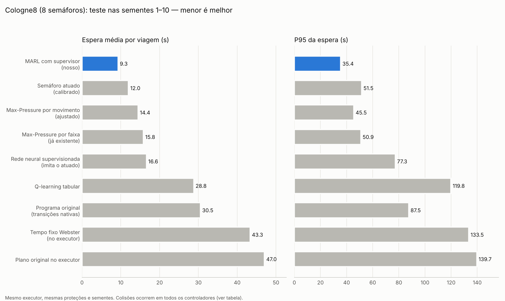

# MARL x outros controladores no Cologne8

Experimento feito em 15/11/2026 na branch `experimento/comparadores-cologne8`.
O MARL **não** foi retreinado nem reavaliado: os números dele vêm da análise
conferida da rodada `20261113T011843Z_continuo_10seeds_9f8d757b`
([ANALISE_MARL_COLOGNE8_CONTINUO.md](ANALISE_MARL_COLOGNE8_CONTINUO.md)).

## Pergunta

O MARL com supervisor é melhor do que controladores tradicionais **bem
calibrados** e do que métodos de aprendizado mais simples, testados nas mesmas
condições?

## Como a comparação foi feita (por que ela é justa)

- **Mesmo executor:** todos os controladores rodam dentro de
  `ambiente_marl_cologne.rodar`, na cópia congelada em `fontes_execucao/` da
  rodada do MARL. Rede, demanda, aquecimento, verde mínimo de 10 s, decisão a
  cada 5 s, amarelo de 3 s, vermelho geral de 2 s, proteção do verde acima de
  60 s, colisões em modo `warn` e métricas são idênticos. Só muda quem escolhe a fase.
- **Conferência do ambiente:** o Max-Pressure e o programa original foram
  rodados de novo aqui e reproduziram exatamente os valores da análise do MARL
  (15,83 s e 30,52 s nas sementes 1 a 10).
- **Mesmas sementes:** treino 1000+, validação 201/202 e teste 1 a 10.
  Todo ajuste de parâmetro e toda escolha de modelo usaram só a validação.
- **Modelos aprendidos:** 3 sementes de treino por método; a escolha do
  checkpoint usou **a mesma regra do MARL** (menos colisões, depois menos
  viagens não concluídas, depois menor espera, na validação).

## Controladores comparados

| Controlador | O que é | Como foi calibrado |
|---|---|---|
| **Semáforo atuado** | Mantém o verde enquanto há carros chegando nos movimentos liberados (a até *d* metros da faixa de retenção) e troca para a próxima fase com demanda | Grade de verde máximo (20–55 s) × distância (20–80 m); escolhido: 40 s e 20 m |
| **Max-Pressure por movimento** | Versão da literatura: pressão de cada movimento (carros parados que vão fazer aquele movimento menos parados na saída) | Grade de verde mínimo × histerese; escolhido: 10 s, histerese 0 |
| **Max-Pressure por faixa** | O que já existia no projeto | A grade de ajuste não superou a versão original, que foi mantida |
| **Rede neural supervisionada** | MLP 64-64, a mesma arquitetura das redes locais do MARL e o mesmo vetor de observação, treinada para **copiar** o melhor controlador clássico na validação (o atuado). Behavior cloning com 20 episódios + 3 iterações de DAgger | Iteração escolhida pela regra do MARL |
| **Q-learning tabular** | Um agente por semáforo; estado = fase, faixa de tempo de verde e fila por fase em 5 níveis; mesma recompensa local do MARL **sem** a penalidade de colisão (numa tabela, um único −10.000 apaga o resto) | 300 episódios por semente; ε de 1 a 0,05 |
| **Tempo fixo Webster** | Ciclo e verdes de Webster por cruzamento, com fluxos medidos por movimento | Multiplicador do ciclo escolhido na validação |
| **Programa original** | Tempos e transições nativas do cenário (como na análise do MARL) | — |
| **Plano original no executor** | Os mesmos tempos de verde do programa original, mas com as transições do executor | — |

## Resultado do teste final (sementes 1 a 10)



| Controlador | Simulações | Espera média (s) | P95 (s) | Fila média | Colisões/sim | Não concluídas |
|---|---:|---:|---:|---:|---:|---:|
| **MARL com supervisor (nosso)** | 100 | **9,29** | **35,4** | **4,94** | 18,5 | 0 |
| Semáforo atuado (calibrado) | 10 | 11,98 | 51,5 | 6,39 | **16,6** | 0 |
| Max-Pressure por movimento (ajustado) | 10 | 14,45 | 45,5 | 7,69 | 18,9 | 0 |
| Max-Pressure por faixa (já existente) | 10 | 15,83 | 50,9 | 8,42 | 18,2 | 0 |
| Rede neural supervisionada | 30 | 16,60 | 77,3 | 8,84 | 21,4 | 0 |
| Q-learning tabular | 30 | 28,80 | 119,8 | 15,12 | 20,3 | **36** |
| Programa original (transições nativas) | 10 | 30,52 | 87,5 | 16,01 | 23,6 | 0 |
| Tempo fixo Webster (no executor) | 10 | 43,32 | 133,5 | 22,71 | 30,2 | 0 |
| Plano original no executor | 10 | 47,03 | 139,7 | 24,85 | 29,1 | 0 |

Comparação pareada por semente de tráfego (média dos modelos de cada grupo em cada semente):

| MARL comparado com | Espera média | P95 | Colisões/sim | MARL com menor espera em |
|---|---:|---:|---:|---:|
| Semáforo atuado | −2,69 s (−22%) | −16,1 s (−31%) | **+1,9** | 10/10 sementes |
| Max-Pressure por movimento | −5,16 s (−36%) | −10,1 s (−22%) | −0,4 | 10/10 |
| Max-Pressure por faixa | −6,54 s (−41%) | −15,4 s (−30%) | +0,3 | 10/10 |
| Rede neural supervisionada | −7,31 s (−44%) | −41,9 s | −2,9 | 10/10 |
| Q-learning tabular | −19,51 s (−68%) | −84,4 s | −1,9 | 10/10 |

Tabelas completas, variação entre modelos e valores por rodada:
`resultados/comparadores_cologne8/tabelas.md`, `resumo.json` e `teste/<grupo>.json`.

## O que os resultados mostram

1. **O MARL tem a menor espera e o menor P95 contra todos os comparadores**, em
   todas as 10 sementes. Contra o adversário mais forte, o semáforo atuado
   calibrado, a vantagem é de **22% na espera média e 31% no P95**. Esse é o
   número honesto para a apresentação; os 41% da análise anterior eram contra
   um Max-Pressure que não era o melhor controlador clássico disponível.
2. **Segurança continua em aberto.** O semáforo atuado teve **menos colisões**
   que o MARL (16,6 contra 18,5 por simulação). Todos os controladores colidem
   no cenário, o que reforça a necessidade de auditar o próprio cenário.
3. **Imitar não basta.** A rede supervisionada acerta de 84% a 100% das ações
   do professor em cada semáforo e, ainda assim, fica pior que ele (16,6 s
   contra 12,0 s). Ela usa a mesma arquitetura e as mesmas entradas do MARL. A
   diferença é **como aprende**: copiando decisões de um professor, os pequenos
   erros se acumulam e ela nunca vê a consequência das próprias escolhas. Por
   reforço, o MARL aprende com o efeito das decisões no trânsito e supera o
   melhor professor disponível.
4. **Tabela não escala.** O Q-learning tabular ficou em 28,8 s, com grande
   variação entre sementes (24,6 a 33,7 s), e deixou 36 viagens sem concluir
   em 4 das 30 rodadas. Cada combinação de fila é uma linha nova da tabela, e
   o agente não generaliza para situações parecidas. Esse é o motivo para usar
   uma rede neural como aproximadora da função Q (a DQN).
5. **O tempo fixo é prejudicado pelas regras de transição do executor.** O
   mesmo plano original passa de 30,5 s, com as transições nativas, para
   47,0 s no executor, que impõe 3 s de amarelo e 2 s de vermelho geral a
   cada troca de fase. O Webster (43,3 s) é um pouco melhor que esse plano
   nas mesmas regras. Não se deve apresentar o tempo fixo como "derrota
   fácil" sem explicar isso.

## Limitações

- **Uma só demanda.** As sementes mudam a execução estocástica, não o trânsito
  (a mesma limitação do MARL). Generalização não foi testada.
- **Q-learning com menos episódios:** 300 por semente, contra 500 do MARL,
  por limite de tempo de execução. Ele ainda melhorava no fim.
- **A regra de seleção pesou contra o Q-learning.** Colisões em duas sementes
  de validação são ruidosas. Pela regra do MARL foram escolhidos checkpoints
  com 22,7 a 28,2 s na validação, quando outros checkpoints chegaram a cerca
  de 16 s. A regra foi mantida igual à do MARL de propósito, para não
  favorecer nenhum método.
- **Os clássicos usam informação que o MARL não observa.** O atuado e o
  Max-Pressure por movimento sabem qual movimento cada carro vai fazer
  (`getNextTLS`); o MARL observa filas e contagens por aproximação. Isso
  favorece os clássicos.
- **Webster aproximado:** a saturação foi fixada em 1.800 veículos/h por faixa
  e o fluxo de um movimento liberado em várias fases foi dividido entre elas.
- **Q-learning sem penalidade de colisão**, como descrito acima.
- Os arquivos `tripinfo.xml.gz` (cerca de 75 MB) não foram versionados. Os
  testes são determinísticos e podem ser recriados com os comandos abaixo.
  `metricas.json` de cada rodada está versionado.
- Os modelos aprendidos estão em `pickle`. Só carregue arquivos gerados por
  vocês mesmos.

## Como reproduzir

Requer SUMO 1.28.0 (`libsumo`), NumPy e scikit-learn. Na pasta `semaforo/scripts`:

```bash
python comparadores_cologne8.py calibrar                 # clássicos, validação 201/202 (~10 min)
python comparadores_cologne8.py qlearning --semente 0 --episodios 300   # repetir para 1 e 2
python comparadores_cologne8.py imitacao --semente 0     # repetir para 1 e 2
python comparadores_cologne8.py avaliar --grupo atuado_calibrado        # um grupo por vez
python relatorio_comparadores_cologne8.py                # tabelas e gráfico
```

Grupos para `avaliar`: `atuado_calibrado`, `max_pressure_movimento_ajustado`,
`max_pressure_faixa_ajustado`, `max_pressure_executor`, `original_fixo`,
`webster_calibrado`, `plano_original_no_executor`, `imitacao_mlp` e
`qlearning_tabular`.

Cada simulação levou cerca de 4 s no ambiente usado (Linux, 2 CPUs).

## Arquivos

- `scripts/comparadores_cologne8.py`: os controladores, a calibração, os treinos e a avaliação.
- `scripts/relatorio_comparadores_cologne8.py`: as tabelas, a comparação pareada e o gráfico.
- `resultados/comparadores_cologne8/calibracao_classicos.json`: as grades de calibração e os fluxos medidos.
- `resultados/comparadores_cologne8/modelos/`: os modelos aprendidos e os históricos de treino (`preliminar_qlearning_200ep_seed0` é uma primeira rodada interrompida, guardada só como registro).
- `resultados/comparadores_cologne8/teste/`: as métricas de cada rodada de teste.
