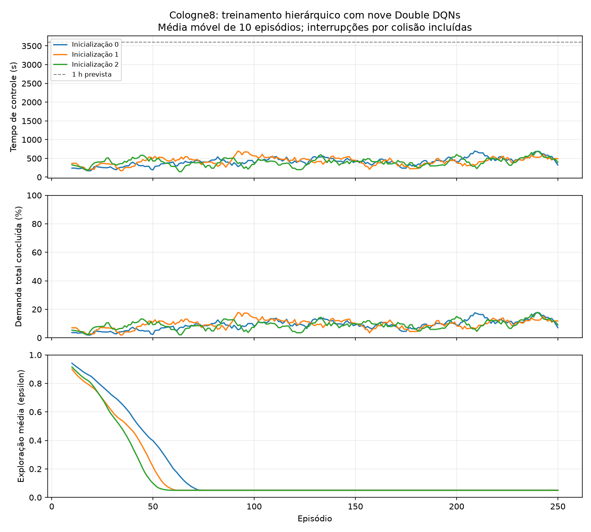

# Resultado da rodada MARL com supervisor - cologne8

Gerado em 2026-11-13T00:52:38.005831+00:00. Rodada `20261113T003357Z_treinar_afff873a`.

Foram concluidos **3 treinamentos de 250 episodios** (total 750), com oito DQNs locais e uma DQN supervisora por inicializacao.

**750/750 episodios de treino terminaram por colisao**. A exposicao efetiva foi 85.28 horas simuladas, e nao 750 horas completas. Cada evento recebeu -10000 por ator e encerrou o episodio. Isso documenta uma rodada executada; nao aprova a politica para operacao.

## Teste final com seed 1

Mesma demanda, rede e protocolo; teste sem exploracao. As linhas interrompidas possuem duracoes e populacoes diferentes. Espera/P95 abaixo referem-se somente a quem concluiu a viagem antes da interrupcao: **nao permitem ordenar eficiencia**.

| Controle | Controle simulado (s) | Colisoes | Concluidos/previstos | Em viagem ao encerrar | Ainda nao inseridos* | Espera parcial (s) | P95 parcial (s) | Intervencoes |
|---|---:|---:|---:|---:|---:|---:|---:|---:|
| MARL seed 0 (ep 100) | 820 | 1 | 432/2046 | 80 | 1534 | 8.6 | 36.0 | 18 |
| MARL seed 1 (ep 100) | 965 | 2 | 556/2046 | 90 | 1400 | 10.0 | 34.2 | 21 |
| MARL seed 2 (ep 125) | 430 | 1 | 163/2046 | 60 | 1823 | 7.0 | 29.0 | 9 |
| max_pressure | 441 | 1 | 168/2046 | 62 | 1816 | 6.6 | 20.7 | 9 |
| original_fixo | 187 | 1 | 47/2046 | 54 | 1945 | 20.7 | 52.0 | 0 |

*Ainda nao inseridos inclui partidas futuras que nao foram alcancadas porque o episodio terminou cedo, alem de eventual atraso na entrada. `pendentes_insercao` separa os veiculos que ja deveriam entrar naquele instante.

O programa original usa seus proprios tempos; Max-Pressure usa as mesmas protecoes do MARL e nao recebeu calibracao dedicada. Nenhum e apresentado como teto teorico.

## Inicializacoes e checkpoints

| Inicializacao | Melhor episodio pela validacao | Colisoes no treino | Horas efetivas | Episodios chegaram a 28800 s |
|---|---:|---:|---:|---:|
| 0 | 100 | 250 | 28.38 | 0 |
| 1 | 100 | 250 | 29.40 | 0 |
| 2 | 125 | 250 | 27.50 | 0 |

Validacao: seeds 201 e 202 a cada 25 episodios. Selecao lexicografica por colisoes, demanda prevista nao concluida (incluindo partidas futuras) e espera afetada. Cada checkpoint contem os nove atores do mesmo episodio.

- Seed 0: [politica_ep0100.pt](modelo_seed0/politica_ep0100.pt); SHA-256 `dc4abf6d944ec670c9d1a1026c1def6d2bc8887e472dee0da455f7a13156168b`. Estado final para retomada: `modelo_seed0/ultimo_completo.pt`.
- Seed 1: [politica_ep0100.pt](modelo_seed1/politica_ep0100.pt); SHA-256 `4609565fa7f17d50f4dfc89a4af6a9797cd080de272ec1ff522f12bbbfcf2700`. Estado final para retomada: `modelo_seed1/ultimo_completo.pt`.
- Seed 2: [politica_ep0125.pt](modelo_seed2/politica_ep0125.pt); SHA-256 `fa14f969a985c6c15a120414b0e822396cb35d9927ae3d0d479b5838903eab4a`. Estado final para retomada: `modelo_seed2/ultimo_completo.pt`.

## Ablacao do canal supervisor

Mesmas redes treinadas, mas orientacao fixada em equilibrado. Nao e um treinamento independente sem supervisor e nao isola causalmente a hierarquia.

| Controle | Controle simulado (s) | Colisoes | Concluidos/previstos | Em viagem ao encerrar | Ainda nao inseridos* | Espera parcial (s) | P95 parcial (s) | Intervencoes |
|---|---:|---:|---:|---:|---:|---:|---:|---:|---:|
| Seed 0, orientacao zero | 772 | 1 | 391/2046 | 65 | 1590 | 8.7 | 35.5 | 18 |
| Seed 1, orientacao zero | 777 | 1 | 398/2046 | 61 | 1587 | 8.3 | 28.0 | 23 |
| Seed 2, orientacao zero | 811 | 1 | 427/2046 | 71 | 1548 | 7.2 | 26.0 | 14 |

## O que foi verificado

- 818 execucoes conferidas contra os tripinfo comprimidos; conservacao de viagens, espera, P95, censura, colisoes e penalidades.
- 6693 decisoes com dimensoes/Qs finitos, acao no conjunto valido, argmax sem exploracao e mapeamento para fase real.
- 4129 eventos de fase conferidos, incluindo 3 s de amarelo e 2 s de vermelho local em transicoes concluidas.
- 145 arquivos preexistentes preservaram o SHA-256 anterior ao trabalho.
- Nove atores com gradientes, pesos finitos, checkpoints escolhidos e ultimos estados completos; hashes das fontes de treino preservadas em `fontes_execucao/`.

## Erros, acertos e proximo passo

Acertos: controle simultaneo de oito nos, formatos locais derivados das fases reais, supervisor treinavel, penalidade terminal alta, replay com acao executada, fim explicito, desconto por duracao e avaliacao sem aprendizado. Esses componentes foram exercitados e possuem evidencias preservadas.

Problema central: o programa original do cologne8 tambem colidiu sem RL. Reprocessar a rede com netconvert e reduzir o passo nao eliminaram todos os casos; a copia reprocessada nao foi usada neste treino. Fases G/g permitem movimentos com prioridade; tempos de amarelo/vermelho, por si sos, nao garantem que veiculos ja no interior tenham liberado todas as trajetorias conflitantes.

Nao e possivel concluir que MARL ou supervisor melhoraram o transito com medias de viagens interrompidas. A penalidade alta tambem nao demonstrou garantia de seguranca. Nao comparar esses numeros diretamente ao cruzamento sintetico ou cologne1. As viagens OD/horarios sao fixas entre treino/teste.

Menor proximo passo: reproduzir um evento de colisao com os links/fases e veiculos envolvidos, auditar prioridades/geometria interna e o esvaziamento do cruzamento nas transicoes. Corrigir e versionar uma copia derivada antes de gastar outra rodada longa. Depois exigir episodios completos, vazao e espera nao censuradas e um treino separado sem supervisor para medir seu ganho.

Manter os nove atores, mapeamentos auditados, protecoes locais, penalidades, separacao de sementes, checkpoints completos e registros. Revisar a validacao do ambiente e a atribuicao/evitabilidade de colisoes antes de ampliar o treino.

## Reproducao e rastreabilidade

`protocolo.json` registra os argumentos reais. `manifesto.json` define as entradas, acoes, fontes e tempos. `historico.jsonl` registra cada episodio; `verificacao_final.json` contem os totais conferidos. O desenho completo e as tentativas anteriores estao em `semaforo/TREINO_MARL_SUPERVISOR_COLOGNE8.md`.

