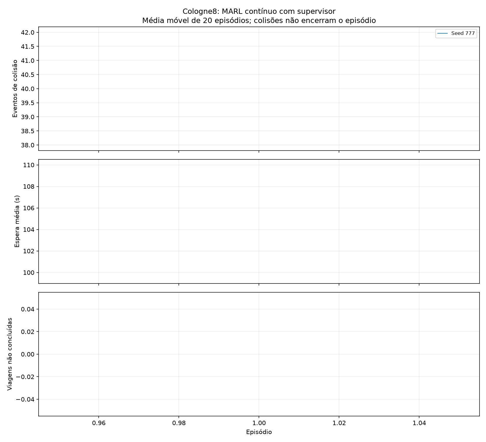

# MARL cologne8: rodada longa sem encerrar por colisao

Rodada `20261113T011248Z_continuo_bf6c3fff`. 1 inicializacoes × 1 episodios = **1 episodios**, com oito DQNs locais e uma supervisora por inicializacao.

Exposicao efetiva: **1.16 horas simuladas**. Eventos de colisao no treino: **40**. Episodios encerrados por colisao: **0**.

Colisao recebe -10000 por novo contato para cada ator, sem terminar o episodio. Contato persistente do mesmo par em passos consecutivos conta uma vez; apos separacao um novo contato conta novamente. SUMO collision.action=warn: nao remove nem teleporta os veiculos por causa da colisao. Isso e um experimento simulado com contatos detectados, nao uma validacao fisica de acidentes reais.

## Teste final

Media ± desvio padrao entre sementes de trafego. Espera inclui viagens em andamento como limite inferior; a coluna nao concluidas indica censura. P95 e a media dos P95 de cada rodada, nao um percentil agrupado. Mesmas origens/destinos/horarios entre sementes, com estocasticidade do SUMO.

| Controle | Rodadas | Espera (s) | P95 (s) | Colisoes/rodada | Nao concluidas (soma) | Viagens concluidas/rodada |
|---|---:|---:|---:|---:|---:|---:|
| MARL modelo seed 777 (ep 1) | 1 | 127.17 ± 0.00 | 628.35 ± 0.00 | 41.00 ± 0.00 | 65 | 1981.00 ± 0.00 |
| max_pressure | 1 | 15.09 ± 0.00 | 46.00 ± 0.00 | 15.00 ± 0.00 | 0 | 2046.00 ± 0.00 |
| original_fixo | 1 | 30.70 ± 0.00 | 89.00 ± 0.00 | 16.00 ± 0.00 | 0 | 2046.00 ± 0.00 |

Nao selecionar o melhor modelo pelas sementes finais: cada conjunto acima foi escolhido pelas seeds de validacao 201/202. Colisoes, nao atendimento, espera e filas devem ser considerados juntos; reduzir espera com muitas colisoes nao e um resultado satisfatorio.

## Checkpoints e aprendizagem

- Seed 777: episodio escolhido 1; checkpoint `resultados\marl_cologne8\20261113T011248Z_continuo_bf6c3fff\modelo_seed777\politica_ep0001.pt`; SHA-256 `0e0277bc959bbd4acf0fddad863041c0c0b906ce42d9afb48b4efe447466cf10`; estado completo `C:\Users\Ana Paula\Documents\ChatGPT\Insper AI\Entrega_Final_InsperAI\semaforo\resultados\marl_cologne8\20261113T011248Z_continuo_bf6c3fff\modelo_seed777\estado_ep0001.pt`.

## Ablacao da orientacao do supervisor

Mesmas redes condicionadas, orientacao fixada em equilibrado. Nao equivale a um treino independente sem supervisor e nao estabelece ganho causal da hierarquia.

| Controle | Rodadas | Espera (s) | P95 (s) | Colisoes/rodada | Nao concluidas (soma) | Viagens concluidas/rodada |
|---|---:|---:|---:|---:|---:|---:|
| Seed 777, orientacao zero | 1 | 127.17 ± 0.00 | 628.35 ± 0.00 | 41.00 ± 0.00 | 65 | 1981.00 ± 0.00 |

## Protocolo e verificacao

Treino SUMO: 1000+episodio; validacao: [201, 202]; teste: [1]. Rede/demanda originais cologne8 do SUMO-RL 1.4.5, SUMO 1.28.0; intervalo local 5 s, supervisor 30 s; verde minimo 10, amarelo 3, vermelho integral local 2, maximo condicional 60 s. Locais podem estar verdes simultaneamente.

Replay 50000 por ator, lote 64, aquecimento 2000, Adam 5e-4, Huber, alvo a cada 500 gradientes; gamma=0,95^(dt/5), epsilon local de 100% a 5% em 40000 decisoes e supervisor em 10000. Final natural/corte de escoamento fecha a experiencia; colisao mantem bootstrap e as proximas decisoes. Nenhum peso da rodada anterior foi convertido ou atualizado nesta rodada.

Conferidas 7 execucoes, 9991 decisoes e 7013 eventos de fase. 3603 arquivos anteriores preservaram seus hashes; scripts alterados tiveram backup anterior. Fontes executadas estao congeladas em `fontes_execucao/`, parametros em `protocolo.json`, progresso em JSONL.

## Limites e comparacao com a rodada anterior

A rodada anterior parava no primeiro evento e teve exposicao curta; comparar diretamente suas esperas ou seus totais de colisoes com os daqui seria inadequado. Agora a demanda inteira pode ser atendida mesmo depois de uma colisao, como solicitado. Isso permite estudar consequencias e aprendizagem ao longo da hora, mas nao elimina os conflitos observados tambem no programa original. Nao ha conclusao de generalizacao para outras cidades, horarios ou demandas.

