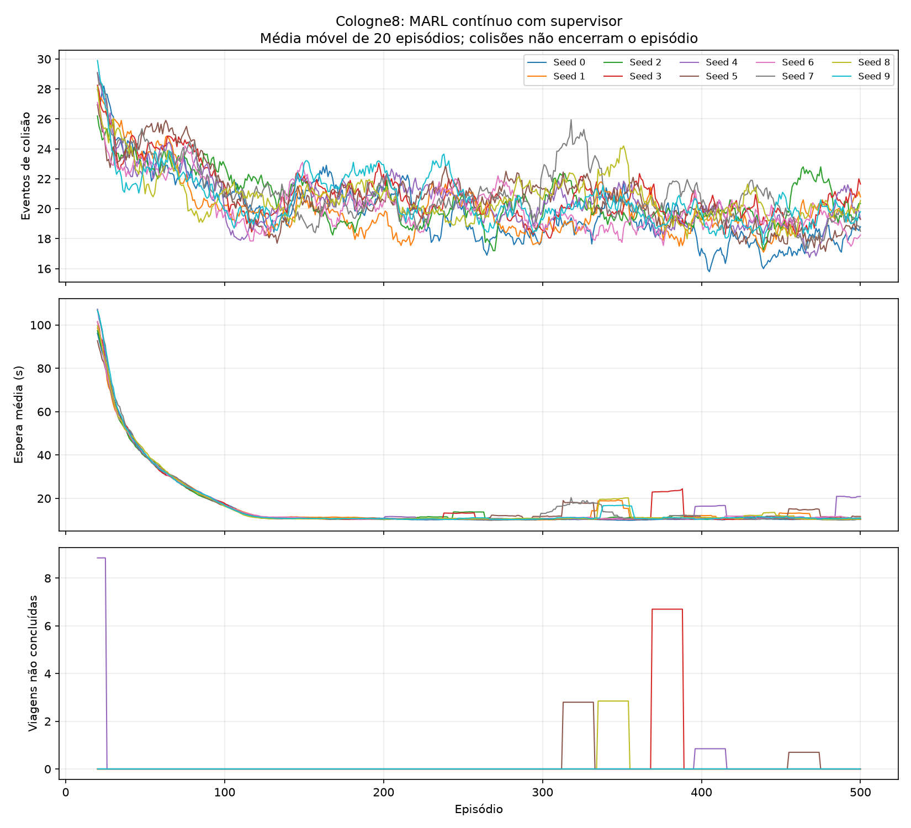

# MARL cologne8: rodada longa sem encerrar por colisao

Rodada `20261113T011843Z_continuo_10seeds_9f8d757b`. 10 inicializacoes × 500 episodios = **5000 episodios**, com oito DQNs locais e uma supervisora por inicializacao.

Exposicao efetiva: **5362.22 horas simuladas**. Eventos de colisao no treino: **103583**. Episodios encerrados por colisao: **0**.

Colisao recebe -10000 por novo contato para cada ator, sem terminar o episodio. Contato persistente do mesmo par em passos consecutivos conta uma vez; apos separacao um novo contato conta novamente. SUMO collision.action=warn: nao remove nem teleporta os veiculos por causa da colisao. Isso e um experimento simulado com contatos detectados, nao uma validacao fisica de acidentes reais.

## Teste final

Media ± desvio padrao entre sementes de trafego. Espera inclui viagens em andamento como limite inferior; a coluna nao concluidas indica censura. P95 e a media dos P95 de cada rodada, nao um percentil agrupado. Mesmas origens/destinos/horarios entre sementes, com estocasticidade do SUMO.

| Controle | Rodadas | Espera (s) | P95 (s) | Colisoes/rodada | Nao concluidas (soma) | Viagens concluidas/rodada |
|---|---:|---:|---:|---:|---:|---:|
| MARL modelo seed 0 (ep 375) | 10 | 8.55 ± 0.29 | 33.40 ± 1.83 | 18.60 ± 5.85 | 0 | 2046.00 ± 0.00 |
| MARL modelo seed 1 (ep 375) | 10 | 9.40 ± 0.48 | 36.90 ± 3.18 | 17.20 ± 3.26 | 0 | 2046.00 ± 0.00 |
| MARL modelo seed 2 (ep 150) | 10 | 9.81 ± 0.31 | 35.98 ± 1.20 | 19.40 ± 4.84 | 0 | 2046.00 ± 0.00 |
| MARL modelo seed 3 (ep 375) | 10 | 8.92 ± 0.22 | 34.08 ± 1.29 | 19.00 ± 4.50 | 0 | 2046.00 ± 0.00 |
| MARL modelo seed 4 (ep 450) | 10 | 9.21 ± 0.43 | 34.20 ± 1.48 | 19.10 ± 5.95 | 0 | 2046.00 ± 0.00 |
| MARL modelo seed 5 (ep 300) | 10 | 8.79 ± 0.20 | 33.73 ± 1.51 | 17.10 ± 3.00 | 0 | 2046.00 ± 0.00 |
| MARL modelo seed 6 (ep 500) | 10 | 9.78 ± 0.51 | 37.65 ± 1.35 | 16.30 ± 4.90 | 0 | 2046.00 ± 0.00 |
| MARL modelo seed 7 (ep 475) | 10 | 8.97 ± 0.39 | 34.55 ± 1.65 | 19.40 ± 4.25 | 0 | 2046.00 ± 0.00 |
| MARL modelo seed 8 (ep 50) | 10 | 10.54 ± 0.39 | 40.25 ± 1.73 | 19.40 ± 3.53 | 0 | 2046.00 ± 0.00 |
| MARL modelo seed 9 (ep 375) | 10 | 8.95 ± 0.39 | 33.58 ± 2.30 | 19.10 ± 5.00 | 0 | 2046.00 ± 0.00 |
| max_pressure | 10 | 15.83 ± 1.74 | 50.85 ± 9.14 | 18.20 ± 4.66 | 0 | 2046.00 ± 0.00 |
| original_fixo | 10 | 30.52 ± 0.58 | 87.55 ± 2.69 | 23.60 ± 6.26 | 0 | 2046.00 ± 0.00 |

Nao selecionar o melhor modelo pelas sementes finais: cada conjunto acima foi escolhido pelas seeds de validacao 201/202. Colisoes, nao atendimento, espera e filas devem ser considerados juntos; reduzir espera com muitas colisoes nao e um resultado satisfatorio.

## Checkpoints e aprendizagem

- Seed 0: episodio escolhido 375; checkpoint `resultados\marl_cologne8\20261113T011843Z_continuo_10seeds_9f8d757b\modelo_seed0\politica_ep0375.pt`; SHA-256 `008d4ce83508e0539d7edc811f2550dbed04a950f7f6ef88349975c2fc5e8f0c`; estado completo `C:\Users\Ana Paula\Documents\ChatGPT\Insper AI\Entrega_Final_InsperAI\semaforo\resultados\marl_cologne8\20261113T011843Z_continuo_10seeds_9f8d757b\modelo_seed0\estado_ep0500.pt`.
- Seed 1: episodio escolhido 375; checkpoint `resultados\marl_cologne8\20261113T011843Z_continuo_10seeds_9f8d757b\modelo_seed1\politica_ep0375.pt`; SHA-256 `0f7de62b27c9f91572a5ed3a8dd2f3274e480a78ce026b1f97f81c00a4994a9d`; estado completo `C:\Users\Ana Paula\Documents\ChatGPT\Insper AI\Entrega_Final_InsperAI\semaforo\resultados\marl_cologne8\20261113T011843Z_continuo_10seeds_9f8d757b\modelo_seed1\estado_ep0500.pt`.
- Seed 2: episodio escolhido 150; checkpoint `resultados\marl_cologne8\20261113T011843Z_continuo_10seeds_9f8d757b\modelo_seed2\politica_ep0150.pt`; SHA-256 `fafc9bedffecbcdd0bf75b2e5d91ae031508203c1aa79020aea75d2a05a29e38`; estado completo `C:\Users\Ana Paula\Documents\ChatGPT\Insper AI\Entrega_Final_InsperAI\semaforo\resultados\marl_cologne8\20261113T011843Z_continuo_10seeds_9f8d757b\modelo_seed2\estado_ep0500.pt`.
- Seed 3: episodio escolhido 375; checkpoint `resultados\marl_cologne8\20261113T011843Z_continuo_10seeds_9f8d757b\modelo_seed3\politica_ep0375.pt`; SHA-256 `abcce485e94b8218ac8faf847bdaf0c49bddca065df682fda1417b2757f1abad`; estado completo `C:\Users\Ana Paula\Documents\ChatGPT\Insper AI\Entrega_Final_InsperAI\semaforo\resultados\marl_cologne8\20261113T011843Z_continuo_10seeds_9f8d757b\modelo_seed3\estado_ep0500.pt`.
- Seed 4: episodio escolhido 450; checkpoint `resultados\marl_cologne8\20261113T011843Z_continuo_10seeds_9f8d757b\modelo_seed4\politica_ep0450.pt`; SHA-256 `e76d312acaeafe0b782c1f378c238ca4675e2552e06fbe9e0471a94a0db57f8c`; estado completo `C:\Users\Ana Paula\Documents\ChatGPT\Insper AI\Entrega_Final_InsperAI\semaforo\resultados\marl_cologne8\20261113T011843Z_continuo_10seeds_9f8d757b\modelo_seed4\estado_ep0500.pt`.
- Seed 5: episodio escolhido 300; checkpoint `resultados\marl_cologne8\20261113T011843Z_continuo_10seeds_9f8d757b\modelo_seed5\politica_ep0300.pt`; SHA-256 `0ad924befbf3b3dccd1f73b057dabcfa8da24f9c15395510eb7899c7fd3d3f4b`; estado completo `C:\Users\Ana Paula\Documents\ChatGPT\Insper AI\Entrega_Final_InsperAI\semaforo\resultados\marl_cologne8\20261113T011843Z_continuo_10seeds_9f8d757b\modelo_seed5\estado_ep0500.pt`.
- Seed 6: episodio escolhido 500; checkpoint `resultados\marl_cologne8\20261113T011843Z_continuo_10seeds_9f8d757b\modelo_seed6\politica_ep0500.pt`; SHA-256 `581a7e919e2ae31a3df0def73937f06b826cfdb1dfa6ff83a30e97c69ac1c829`; estado completo `C:\Users\Ana Paula\Documents\ChatGPT\Insper AI\Entrega_Final_InsperAI\semaforo\resultados\marl_cologne8\20261113T011843Z_continuo_10seeds_9f8d757b\modelo_seed6\estado_ep0500.pt`.
- Seed 7: episodio escolhido 475; checkpoint `resultados\marl_cologne8\20261113T011843Z_continuo_10seeds_9f8d757b\modelo_seed7\politica_ep0475.pt`; SHA-256 `b16ad0a7674a73ae6559811e345ea5e66d3ac9c85152c9f97a43d0352c64d36e`; estado completo `C:\Users\Ana Paula\Documents\ChatGPT\Insper AI\Entrega_Final_InsperAI\semaforo\resultados\marl_cologne8\20261113T011843Z_continuo_10seeds_9f8d757b\modelo_seed7\estado_ep0500.pt`.
- Seed 8: episodio escolhido 50; checkpoint `resultados\marl_cologne8\20261113T011843Z_continuo_10seeds_9f8d757b\modelo_seed8\politica_ep0050.pt`; SHA-256 `83c09c06d86a232cd711a8eb9e8c45ab32aa433dc4549e20646518157f4eb191`; estado completo `C:\Users\Ana Paula\Documents\ChatGPT\Insper AI\Entrega_Final_InsperAI\semaforo\resultados\marl_cologne8\20261113T011843Z_continuo_10seeds_9f8d757b\modelo_seed8\estado_ep0500.pt`.
- Seed 9: episodio escolhido 375; checkpoint `resultados\marl_cologne8\20261113T011843Z_continuo_10seeds_9f8d757b\modelo_seed9\politica_ep0375.pt`; SHA-256 `a71a16008525b137d991e1e48c240081b2d8389017409f9535fe74d1b467033d`; estado completo `C:\Users\Ana Paula\Documents\ChatGPT\Insper AI\Entrega_Final_InsperAI\semaforo\resultados\marl_cologne8\20261113T011843Z_continuo_10seeds_9f8d757b\modelo_seed9\estado_ep0500.pt`.

## Ablacao da orientacao do supervisor

Mesmas redes condicionadas, orientacao fixada em equilibrado. Nao equivale a um treino independente sem supervisor e nao estabelece ganho causal da hierarquia.

| Controle | Rodadas | Espera (s) | P95 (s) | Colisoes/rodada | Nao concluidas (soma) | Viagens concluidas/rodada |
|---|---:|---:|---:|---:|---:|---:|
| Seed 0, orientacao zero | 10 | 8.95 ± 0.33 | 34.10 ± 2.51 | 18.70 ± 4.35 | 0 | 2046.00 ± 0.00 |
| Seed 1, orientacao zero | 10 | 9.48 ± 0.57 | 36.88 ± 3.47 | 17.60 ± 4.12 | 0 | 2046.00 ± 0.00 |
| Seed 2, orientacao zero | 10 | 10.55 ± 0.41 | 39.27 ± 1.34 | 16.10 ± 4.15 | 0 | 2046.00 ± 0.00 |
| Seed 3, orientacao zero | 10 | 9.38 ± 0.27 | 34.65 ± 0.94 | 18.80 ± 2.82 | 0 | 2046.00 ± 0.00 |
| Seed 4, orientacao zero | 10 | 8.98 ± 0.35 | 34.23 ± 1.59 | 19.40 ± 4.38 | 0 | 2046.00 ± 0.00 |
| Seed 5, orientacao zero | 10 | 8.76 ± 0.30 | 34.55 ± 1.09 | 17.90 ± 2.88 | 0 | 2046.00 ± 0.00 |
| Seed 6, orientacao zero | 10 | 62.00 ± 92.16 | 322.02 ± 491.00 | 26.90 ± 10.60 | 145 | 2031.50 ± 45.85 |
| Seed 7, orientacao zero | 10 | 9.31 ± 0.50 | 36.25 ± 2.11 | 18.00 ± 3.83 | 0 | 2046.00 ± 0.00 |
| Seed 8, orientacao zero | 10 | 10.28 ± 0.39 | 37.60 ± 1.35 | 18.00 ± 5.56 | 0 | 2046.00 ± 0.00 |
| Seed 9, orientacao zero | 10 | 9.26 ± 0.30 | 33.80 ± 1.87 | 16.90 ± 4.36 | 0 | 2046.00 ± 0.00 |

## Protocolo e verificacao

Treino SUMO: 1000+episodio; validacao: [201, 202]; teste: [1, 2, 3, 4, 5, 6, 7, 8, 9, 10]. Rede/demanda originais cologne8 do SUMO-RL 1.4.5, SUMO 1.28.0; intervalo local 5 s, supervisor 30 s; verde minimo 10, amarelo 3, vermelho integral local 2, maximo condicional 60 s. Locais podem estar verdes simultaneamente.

Replay 50000 por ator, lote 64, aquecimento 2000, Adam 5e-4, Huber, alvo a cada 500 gradientes; gamma=0,95^(dt/5), epsilon local de 100% a 5% em 40000 decisoes e supervisor em 10000. Final natural/corte de escoamento fecha a experiencia; colisao mantem bootstrap e as proximas decisoes. Nenhum peso da rodada anterior foi convertido ou atualizado nesta rodada.

Conferidas 5620 execucoes, 481984 decisoes e 414717 eventos de fase. 3603 arquivos anteriores preservaram seus hashes; scripts alterados tiveram backup anterior. Fontes executadas estao congeladas em `fontes_execucao/`, parametros em `protocolo.json`, progresso em JSONL.

## Limites e comparacao com a rodada anterior

A rodada anterior parava no primeiro evento e teve exposicao curta; comparar diretamente suas esperas ou seus totais de colisoes com os daqui seria inadequado. Agora a demanda inteira pode ser atendida mesmo depois de uma colisao, como solicitado. Isso permite estudar consequencias e aprendizagem ao longo da hora, mas nao elimina os conflitos observados tambem no programa original. Nao ha conclusao de generalizacao para outras cidades, horarios ou demandas.

